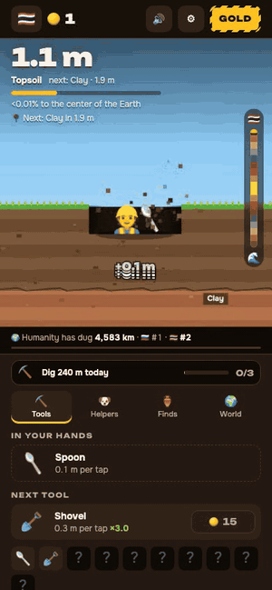

# The Hole World

**The whole world digs one hole. Every meter you dig counts for your country.**

A free tap-to-dig incremental game in the browser and as a Telegram Mini App. You start with a spoon in your own country, dig through the real layers of the Earth (soil, clay, sedimentary rock, granite, the Kola record, the mantle, the core) and come out at your country's real antipode. A live ranking of 114 countries shows who is winning, all-time, today and per capita.

<p align="center">
  <a href="https://thehole.world"></a>
</p>

<p align="center">
  <a href="https://thehole.world"><b>▶ Play in the browser</b></a> &nbsp;·&nbsp;
  <a href="https://t.me/TheHoleWorldBot/play"><b>▶ Play in Telegram</b></a>
</p>

No sign-up. Progress saves in the browser (or in your Telegram account) and syncs to the shared world.

## How it works

- **Tap** to dig. Combo multiplier for fast tapping, soft fatigue instead of an energy wall.
- **Tools**: spoon → shovel → pickaxe → drill → … Each one changes how deep a tap goes.
- **Helpers** dig while you are away (capped offline time, like every honest idle game).
- **Finds**: fossils and treasures appear in the layer you are in. Collect sets for bonuses.
- **Layers are real**: depths, names and facts follow actual geology. The Kola Superdeep Borehole is a milestone. So is the Moho.
- **The world hole**: everyone's meters add up to one shared hole per season. When it reaches the core, everybody digs ×2 for 24 hours and a new season begins.
- **Countries**: a live leaderboard, all-time / today / per capita, plus "overtake" tickers. Small countries can win per capita.
- **Antipodes**: dig from Spain and you surface near New Zealand; dig from Thailand and you surface in the Pacific.
- 12 languages, PWA, share cards with your depth, referral codes.

The client is open source (this repository). The game server (anti-cheat, world state, payments) is a separate private service. The client talks to it through a small JSON API and falls back to a demo world when the API is unreachable, so the game runs fully offline too.

## Run it locally

```bash
npm install
npm run dev        # http://localhost:5173, demo world (no API)
npm test           # unit tests for the economy and i18n
npm run sim        # pacing simulator: prints when a 5 taps/s player reaches each milestone
npm run test:e2e   # Playwright smoke test on phone + desktop viewports
```

Everything about balance lives in `src/config.ts`; the economy itself is pure functions in `src/economy.ts` with tests. The scene is Canvas 2D, no framework, TypeScript strict, Vite.

```
src/
  config.ts      every number that matters (balance, layers, tools, quests, texts)
  economy.ts     pure functions: layer, income, costs, offline, prestige
  game.ts        glue: state, loop, modals, payments
  scene.ts       canvas rendering of the hole
  net.ts         API client + demo fallback
  i18n/          12 languages (PRs welcome)
  ui/            hud, panel, toast, modal, emoji sprite
  platform/      Telegram Mini App glue
```

## Contributing

Translations and balance feedback are the most useful things right now.

- **Translations**: edit `src/i18n/<lang>.json`, run `npm test` (the i18n test checks that every key exists in every language).
- **Balance**: change `src/config.ts`, run `npm run sim` and paste the before/after in the PR.
- **Bugs**: open an issue with the browser, the device and what you tapped.

## License

Code: [MIT](LICENSE). Emoji art: Google Noto Emoji (Apache 2.0). "The Hole World", the name and the logo are not covered by the MIT license.
